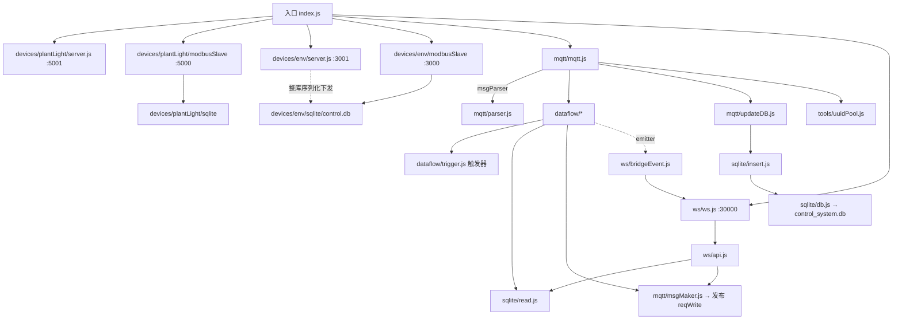
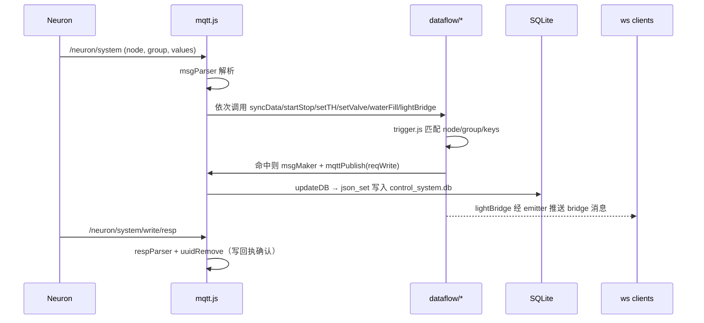

# Plant Grow Lab — Codebase Wiki

## 1. 项目概览

植物生长实验室环境控制系统（`control-system`），Node.js (ESM) 编写，核心职责：

- 作为 **Modbus TCP 从站**，模拟 Neuron 数据采集系统可访问的设备寄存器
- 通过 **MQTT** 与 Neuron 通讯：订阅上报数据、发布写请求
- 将上报数据持久化到 **SQLite**（better-sqlite3, WAL）
- 根据数据触发**业务控制逻辑**（启停、温湿度设定、风阀、加水）
- 通过 **WebSocket (端口 30000)** 对外提供 read/write API 及实时桥接推送
- 每个设备目录自带 HTTP + WS 服务器，把本地 SQLite 整库序列化推给浏览器查看

**依赖**：`better-sqlite3`、`modbus-serial`、`mqtt`、`ws`

## 2. 模块关系图

## 3. 模块说明

| 目录 | 职责 |
| --- | --- |
| `index.js` | 入口：启动 4 个设备服务器 + MQTT（延迟 10s）+ WS 服务器 |
| `config.js` | 全局点表定义（NEWAIR/HEATDEHUM/COOLHUM/PLANT/ENVSYSTEM）、MQTT broker 地址、topic 常量 |
| `mqtt/` | MQTT 客户端、消息解析（`parser.js`）、写消息构造（`msgMaker.js` 带去重 UUID）、入库（`updateDB.js`） |
| `dataflow/` | 业务数据流：`trigger.js`（触发器工厂）+ sync/startStop/setTH/setValve/waterFill/lightBridge |
| `ws/` | WebSocket API 服务器（30000）、路由 `api.js`、桥接事件总线 `bridgeEvent.js` |
| `sqlite/` | 主数据库 `control_system.db`：每张表 `(name, value=JSON)`，用 `json_set` 原子更新 |
| `devices/env/` | 环境控制 Modbus 从站（:3000，unitID 1=SETTING/2=ENV/3=EQ）+ :3001 查看页 |
| `devices/plantLight/` | 植物灯 Modbus 从站（:5000，unitID 1-12 = G11~G43）+ :5001 查看页 |
| `tagSet/` | 向 Neuron（192.168.50.127:7000）批量注册 tag 的脚本工具（tagset.js 手动执行） |
| `tools/` | 自制 EventEmitter、UUID 生成/池、TCP↔COM9 串口透传（独立工具脚本） |

## 4. 核心执行流程

### 4.1 数据上报流程（MQTT main → 处理 → 入库/联动）

### 4.2 外部写入流程（WS → MQTT）

1. 客户端连 `ws://localhost:30000` 发送 `{"func":"write","node":"PLANT","group":"G11","tag":"Y","value":2000}`
2. `api.js:handleWrite` → `msgMaker`（生成 uuid 加入 uuidPool）→ 发布到 `/neuron/system/write/req`
3. Neuron 执行后回 `respWrite`，`mqtt.js` 移除 uuid 并打印成败

### 4.3 读取流程（纯本地）

`{"func":"read",...}` → `sqlite/read.js:getValue(node, group, tag)` → 直接回包，不经过 MQTT。

### 4.4 设备服务器流程（Modbus 从站）

外部 Modbus 主站（Neuron）读写 `:3000/:5000` 寄存器 → `modbusSlave.js` 按 unitID+地址映射到本地 SQLite 表（如 ENV 的 SETTING/ENV/EQ）→ 直接读写本地库；:3001/:5001 网页可整库下载查看。

## 5. 业务逻辑（dataflow）

| 处理器 | 触发条件 | 行为 |
| --- | --- | --- |
| `syncData` | NEWAIR 传感器 / COOLHUM S1-S5 温湿度 | 把传感器值同步写入 ENVSYSTEM/ENV（T1→T6、H1→H6 等） |
| `startStop` | SETTING.KS | KS=1 开启全套设备（风机、制冷×5、温控×2、除湿×2、加湿×5、隔断阀），否则全关 |
| `setTH` | SETTING.TSET/HSET 变化 | 按新设定值下发温度（制冷 TSET、加热 TSET-1）和湿度（除湿 HSET+1、加湿 HSET） |
| `setValve` | ENV.CO2 | CO2>1000 风阀开度 F×2；<800 恢复 F |
| `waterFill` | EQ 的 E11（水位低）/E9（水位高） | 对应机组 wetAdd(1)/(0) 加水/停水 |
| `lightBridge` | PLANT 组 ID/MODE/K/R/B/W | 组装 `func:"bridge"` 消息，经 emitter 广播给所有 WS 客户端 |

## 6. API 一览

**WebSocket（:30000）** — 消息格式见 `api.js`：

- `read`：`{func, node, group, tag}` → 返回 `{func:"read", ..., value}`
- `write`：`{func, node, group, tag, value}` → 转发 MQTT，返回 success/error
- `bridge`（仅下发）：植物灯状态实时推送

**MQTT topics**（broker `192.168.50.127:1883`）：

- `/neuron/system`：订阅，数据上报
- `/neuron/system/write/req`：发布写请求（带 uuid）
- `/neuron/system/write/resp`：订阅，写回执

**HTTP/WS**：:3001（环境）、:5001（植物灯）— 静态页 + 发送 `get_db` 可下载最新 SQLite 快照。

**Neuron REST**（tagSet/tagManager.js，脚本用）：`POST /api/v2/login`、`GET /api/v2/tags`、`POST /api/v2/gtags`。

## 7. 数据模型

- **主库 `control_system.db`**：5 张表（NEWAIR/HEATDEHUM/COOLHUM/PLANT/ENVSYSTEM），每行 `name TEXT PK, value TEXT(JSON)`，由 `config.js` 点表初始化（init.js 手动运行）。
- **设备库（env/plantLight）**：每张表 `(ID INTEGER PK, Value INTEGER)`，ID 对应 Modbus 寄存器地址+1。

## 8. 已知注意事项

- `sqlite/init.js` 使用独立的 `Database` 实例而非共享 `db.js`，且需手动运行一次建表。
- `tagSet/tagset.js` 中硬编码了 JWT token 与密码，属工具脚本，注意不要提交到公开仓库。
- WS `write` 中 `handleWrite` 对 `const {value}` 解构后重新赋值（`value = parseInt(value)`），虽可运行但不规范。
